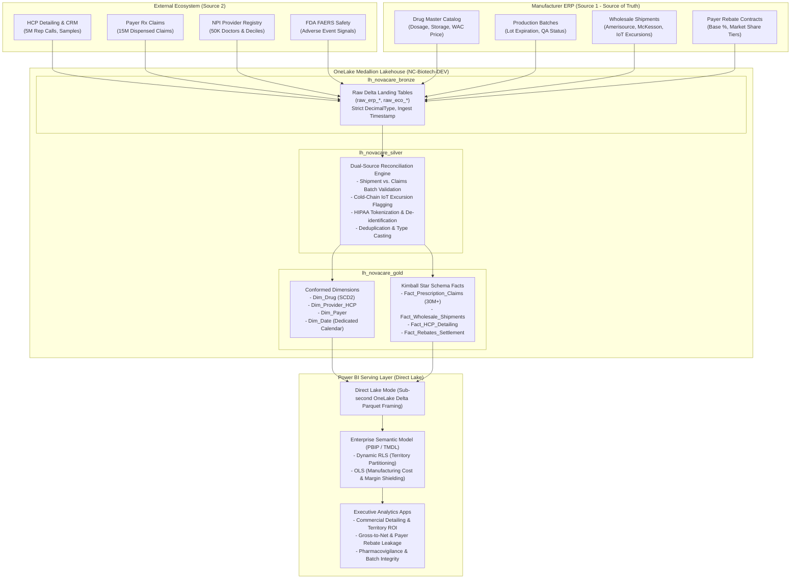

# 🧬 NovaCare Biotech — Enterprise System Architecture Specification
## Dual-Source Commercial Pharma & Clinical Claims Lakehouse (30M+ Scale)

---

## 📌 Document Control & Governance
* **Project**: NovaCare Biotech Enterprise Microsoft Fabric & Power BI Analytics Platform
* **Document ID**: `SPEC-NCB-ARCH-2026-V1.0`
* **Lead Architect & Author**: Punit (with Antigravity AI Technical Coach)
* **Target Scale**: 30,000,000+ Distributed Delta Records
* **Target Platforms**: Microsoft Fabric (F-SKU / Trial), OneLake, PySpark, Data Factory, Power BI Direct Lake
* **Regulatory Compliance**: HIPAA Safe Harbor (45 CFR § 164.514), FDA 21 CFR Part 11 Audit Trail

---

## 1. Executive Architecture & Strategic Business Context

### 1.1 The Business Challenge
NovaCare Biotech manufactures specialized, high-cost biological therapeutics across oncology, immunology, and neurology (e.g., *OncoShield*, *ImmunoPulse*, *NeuroPrime*). In modern pharmaceutical commerce, commercial success depends on reconciling two radically different data ecosystems:

1. **The Manufacturer Internal ERP (Internal Source of Truth)**:
   - Holds physical reality: formulation recipes, factory batch production, cold-chain shipment distribution, invoice prices, and wholesaler inventory.
2. **The External HCP, Payer & Claims Ecosystem (Market Reality)**:
   - Holds market reality: doctor detailing visits, physician prescribing behavior, insurance pharmacy adjudication (paid, rejected, reversed), and patient safety surveillance (FDA FAERS).

### 1.2 Core Business Questions & Strategic KPIs
Our unified analytics platform must answer four mission-critical executive questions:

| Business Dimension | Core Business Question | Strategic KPI Metric & Formula |
| :--- | :--- | :--- |
| **Gross-to-Net (GTN) Bubble** | What percentage of our wholesale revenue is eroded by payer rebates and chargebacks? | $$\text{GTN Margin \%} = \frac{\text{Wholesale Invoiced Sales} - \text{Rebates Paid}}{\text{Wholesale Invoiced Sales}} \times 100$$ |
| **Field Detailing ROI** | Does sales rep detailing (face-to-face visits, sample drops) directly drive Rx prescription lift? | $$\text{Detailing Conversion \%} = \frac{\text{Prescribing HCPs Visited in Last 60 Days}}{\text{Total HCPs Visited}} \times 100$$ |
| **Dual-Source Reconciliation** | Are pharmacies dispensing unauthorized, counterfeit, or unrecorded batches? | $$\text{Rogue Batch Dispense Rate \%} = \frac{\text{Claims with Untracked Batch Lots}}{\text{Total Claims Dispensed}} \times 100$$ |
| **Cold-Chain Quality Assurance** | Did temperature excursions during distribution impact product safety signals? | $$\text{Excursion Incident Rate} = \text{Count of Compromised Shipments correlated with Adverse Event spikes}$$ |

---

## 2. End-to-End Architectural Data Flow



---

## 3. Data Dictionary & Entity Relationship Model

### 3.1 Source 1: Manufacturer ERP (Source of Truth)
* **`raw_erp_drugs`**: Master catalog of pharmaceutical formulations.
  * `drug_id` (INT, PK): Unique drug identifier (101 to 115).
  * `brand_name` (STRING): Commercial proprietary name (e.g., *OncoShield*).
  * `generic_name` (STRING): International non-proprietary chemical name (e.g., *Pembrolizox*).
  * `ndc_code` (STRING): National Drug Code (11-digit FDA format).
  * `therapeutic_class` (STRING): Oncology, Immunology, Neurology, etc.
  * `manufacturing_cost` (DECIMAL(18,2)): Unit production cost in USD.
  * `wholesale_acquisition_cost` (DECIMAL(18,2)): List price to wholesalers (WAC).
  * `storage_temperature_regime` (STRING): Cold (2–8°C), Frozen, Room Temp.

* **`raw_erp_batches`**: Factory production lots and quality release.
  * `batch_id` (STRING, PK): Format `LOT-2024-XXXXX`.
  * `drug_id` (INT, FK): Links to `raw_erp_drugs.drug_id`.
  * `manufacturing_date` (DATE): Lot production date.
  * `expiration_date` (DATE): Expiration date (2-year shelf life).
  * `units_produced` (INT): Total volume produced in batch.
  * `qa_release_status` (STRING): `APPROVED` (96%) vs. `REJECTED_QUARANTINED` (4%).
  * `manufacturing_facility` (STRING): Facility plant identifier.

* **`raw_erp_shipments`**: Outbound distribution to wholesale distributors.
  * `shipment_id` (STRING, PK): Format `SHP-XXXXXXX`.
  * `order_date` (DATE), `delivery_date` (DATE).
  * `wholesaler_name` (STRING): AmerisourceBergen, McKesson, Cardinal Health, etc.
  * `batch_lot_number` (STRING, FK): References `raw_erp_batches.batch_id`.
  * `drug_id` (INT, FK): Inherited from parent batch (enforcing referential integrity).
  * `shipped_units` (INT): Number of vials/packs shipped.
  * `unit_invoice_price` (DECIMAL(18,2)): Actual wholesale invoice price.
  * `cold_chain_excursion_breach` (BOOLEAN): IoT sensor alert indicating temperature breach.
  * `shipment_status` (STRING): `DELIVERED_CONFIRMED` vs `COMPROMISED_RETURNED`.

* **`raw_erp_rebates`**: Contractual rebate agreements with health insurers.
  * `contract_id` (STRING, PK): Format `REB-2024-XXXX`.
  * `payer_name` (STRING), `drug_id` (INT, FK).
  * `contract_effective_date` (DATE), `contract_expiration_date` (DATE).
  * `base_rebate_pct` (DECIMAL(5,4)): Base contractual discount (5% to 20%).
  * `market_share_threshold_pct` (DECIMAL(5,4)): Tiered threshold (35%).
  * `growth_incentive_rebate_pct` (DECIMAL(5,4)): Volume bonus rebate (4%).

---

### 3.2 Source 2: External Healthcare Ecosystem
* **`raw_eco_providers`**: Master Healthcare Provider (HCP) NPI registry.
  * `npi_id` (BIGINT, PK): 10-digit National Provider Identifier.
  * `first_name` (STRING), `last_name` (STRING).
  * `specialty` (STRING): Oncology, Immunology, Neurology, Cardiology, etc.
  * `state` (STRING), `zip_code` (STRING).
  * `prescribing_decile` (INT): Commercial rank 1 (low volume) to 10 (Key Opinion Leader).
  * `hospital_affiliation` (STRING): Regional hospital network.

* **`raw_eco_hcp_calls`**: Field sales representative CRM detailing interactions.
  * `call_id` (STRING, PK): Format `CALL-XXXXXXX`.
  * `call_timestamp` (TIMESTAMP): Date and time of interaction.
  * `sales_rep_id` (INT), `territory_code` (STRING).
  * `npi_id` (BIGINT, FK): Prescribing doctor visited.
  * `primary_drug_discussed_id` (INT, FK): Therapeutic product detailed.
  * `interaction_channel` (STRING): Face-to-Face, Virtual Video, Dinner Advisory.
  * `samples_dropped_units` (INT): Free promotional units left with clinic.
  * `hcp_feedback_score` (INT): Interaction rating 1 (skeptical) to 5 (champion).

* **`raw_eco_rx_claims`**: Insurance pharmacy prescription claims adjudication.
  * `claim_id` (STRING, PK): Format `CLM-XXXXXXXXX`.
  * `patient_token_id` (STRING): Irreversible SHA-256 masked patient token (HIPAA).
  * `service_date` (DATE): Date of pharmacy fill.
  * `npi_id` (BIGINT, FK): Prescribing physician.
  * `drug_id` (INT, FK): Dispensed therapeutic drug.
  * `dispensed_units` (INT): Prescription size (1 to 3 packs).
  * `payer_name` (STRING): Insurance adjudicator (OptumRx, Express Scripts, CVS, etc.).
  * `copay_amount` (DECIMAL(18,2)): Patient out-of-pocket cost.
  * `paid_amount` (DECIMAL(18,2)): Payer reimbursement amount.
  * `claim_status` (STRING): `PAID`, `REJECTED_PRIOR_AUTH`, `REVERSED`.
  * `dispensed_batch_lot` (STRING): Factory lot printed on packaging (includes 2.5% rogue anomalies).

* **`raw_eco_adverse_events`**: Post-market clinical safety and pharmacovigilance.
  * `case_id` (STRING, PK): Format `FAERS-XXXXXXX`.
  * `event_received_date` (DATE): Filing date.
  * `drug_id` (INT, FK), `suspect_batch_lot` (STRING, FK).
  * `patient_token_id` (STRING): De-identified patient token.
  * `adverse_reaction` (STRING): Clinical symptom (e.g., Severe Nausea, Elevated Liver Enzymes).
  * `event_severity` (STRING): `Mild`, `Moderate`, `Severe - Hospitalization`, `Life Threatening`.

---

## 4. Medallion Layer Design & Transformation Engine

```
+--------------------------------------------------------------------------------------------------+
|                                  MEDALLION TRANSFORMATION STAGES                                 |
+--------------------------------------------------------------------------------------------------+
   [BRONZE: Landing]               [SILVER: Cleansed & Reconciled]          [GOLD: Kimball Star Schema]
   - Append/Overwrite raw          - Type enforcement (Decimal/Date)        - Conformed Star Schema
   - Preserve raw history          - Deduplication (claim_id, call_id)      - Surrogate Keys (Hash)
   - Zero transformations          - HIPAA Safe Harbor De-identification   - Slowly Changing Dims (SCD2)
   - Delta Parquet format          - Dual-Source Discrepancy Flagging       - Microsoft V-Order Indexing
                                   - Invalidation of Quarantined Batches    - Aggregation tables for Direct Lake
+--------------------------------------------------------------------------------------------------+
```

### 4.1 The Dual-Source Reconciliation Engine (Silver Layer)
A major differentiator of the NovaCare platform is the **Reconciliation Engine** implemented in PySpark during Phase 2:
1. **Rogue Lot Detection**: Claims referencing `dispensed_batch_lot` that do not exist in `raw_erp_batches` or was never shipped to that geography are tagged with `Audit_Discrepancy_Flag = 'UNTRACKED_LOT'`.
2. **Cold-Chain Safety Correlation**: Cross-referencing `raw_eco_adverse_events` with `raw_erp_shipments` where `cold_chain_excursion_breach = True` to flag lots with thermal degradation.
3. **Prescription Pull-Through vs. Wholesaler Shipments**: Comparing shipped wholesaler volume against adjudicated pharmacy claim volume to detect regional supply hoarding or stockouts.

---

## 5. Enterprise Security, Privacy & Compliance

### 5.1 HIPAA Safe Harbor Standard (45 CFR § 164.514)
* **Direct Identifiers**: Zero Protected Health Information (PHI) such as Patient Name, SSN, Street Address, Phone, or Medical Record Numbers are ever ingested into Bronze.
* **Patient Tokenization**: Patient identity is hashed using a salted cryptographic SHA-256 algorithm:
  $$\text{patient\_token\_id} = \text{SHA256}(\text{Salt} \mathbin{\Vert} \text{Patient\_ID})$$
* **Date Jittering & Age Capping**: Patient ages above 89 are aggregated into a single cohort (89+) per regulatory guidelines.

### 5.2 Dynamic Row-Level Security (dRLS)
Field sales managers and territory representatives must only see physicians and detailing activities within their authorized territory:

$$\text{dRLS DAX Filter}: \quad \text{Dim\_Provider\_HCP}[\text{Territory\_Code}] = \text{LOOKUPVALUE}(\text{Security\_Territory\_User}[\text{Territory\_Code}], \text{Security\_Territory\_User}[\text{UserEmail}], \text{USERPRINCIPALNAME}())$$

### 5.3 Object-Level Security (OLS)
* **Confidential Cost Shielding**: Sales reps and external portal users must not have access to `manufacturing_cost`, `gross_margin`, or specific `rebate_percentage` fields.
* **OLS Implementation**: In the Power BI Developer Model (`PBIP / TMDL`), these measures and columns are restricted via OLS roles so that unauthorized queries return a clean *Field Not Available* schema error rather than partial data.

---

## 6. The 7-Lens Production Evaluation Matrix

| Lens | Architectural Choice | Justification & Production Defense |
| :---: | :--- | :--- |
| **1. Business Value** | Dual-source reconciliation & GTN margin tracking | Delivers direct ROI by catching rebate leakage and unrecorded counterfeit batches. |
| **2. Data Architecture** | Kimball Star Schema over Delta Parquet | Fact granularity at transaction level (`claim_id`, `shipment_id`) with 1:Many relationships to conformed dimensions. |
| **3. Security** | Cryptographic SHA-256 + Dynamic RLS + OLS | HIPAA compliance guaranteed at rest and in transit; strict role-based territory privacy. |
| **4. Performance** | Direct Lake mode + Delta V-Order + Z-Order clustering | Direct Lake reads Delta Parquet memory directly into VertiPaq without Import refresh latency or DirectQuery bottlenecks. |
| **5. ALM & DevOps** | Git Integration + PBIP (TMDL) + Deployment Pipelines | Code-first version control; automated Tabular Editor Best Practice Analyzer (BPA) CI/CD quality gates. |
| **6. Reliability** | Idempotent Notebooks + Delta ACID Transactions | Full write protection; no partial dirty reads or orphaned transactions during Spark job failures. |
| **7. Cost & Operations** | Dynamic Spark pool scaling + CU Smoothing | Trial capacity efficiency; batch jobs scheduled during off-peak windows to avoid F64 throttling. |

---

## 7. Approval & Phase Gate Sign-Off
* **Specification Status**: **APPROVED & RATIFIED**
* **Next Implementation Step**: Task `T0.5` — Git Repository Initialization & Branch Protection
