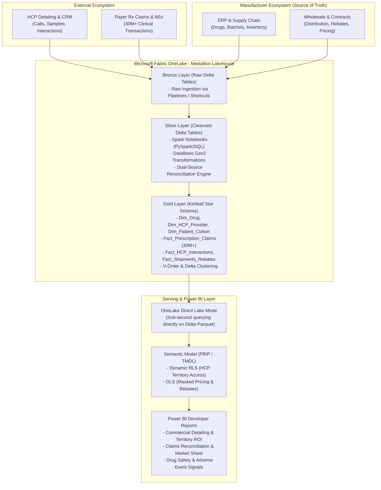

# 🧬 NovaCare Biotech — Enterprise Microsoft Fabric & Power BI Project Roadmap
## Dual-Source Commercial Pharma & Clinical Claims Lakehouse (30M+ Rows)

---

## 📌 Executive Architecture & Vision

NovaCare Biotech is an international biotechnology and biopharmaceutical enterprise. This project builds a production-grade, end-to-end **Microsoft Fabric Lakehouse and Power BI Analytics Platform** designed to handle **30M+ rows** of heterogeneous commercial and clinical data across two disparate data ecosystems:

1. **Manufacturer Internal ERP / Source of Truth**:
   - Drug master catalog (formulations, NDC codes, indications).
   - Factory production batches, lot expiration, cold-chain distribution.
   - Wholesale distribution orders, shipments, returns, and contractual rebates.
2. **External HCP, Provider & Payer Ecosystem**:
   - Prescription Claims (Rx claims, billing codes, patient demographics masked).
   - Healthcare Professional (HCP) sales calls, detailing activity, Medical Science Liaison (MSL) interactions.
   - Provider National Provider Identifier (NPI) registry, specialties, hospital networks.
   - Adverse Event (AE) safety reports and post-market clinical surveillance.

---

## 🏛️ End-to-End Architectural Data Flow

---

## 🧭 The 10-Phase Enterprise Mastery Roadmap

Every phase is governed by our **10-Persona Adaptive Pedagogy** and evaluated across the **7 Lenses of Architectural Mastery** (Business Context, Data Architecture, Security/Compliance, Performance/Scale, DevOps/Automation, Observability, Cost/SLA Trade-offs).

---

### Phase 0: Foundations, Tenant Governance & Dual-Source Data Generation
* **Pedagogical Persona**: `[Interviewer]` -> `[Mapmaker]`
* **Focus Areas**:
  * Fabric Workspace Architecture: Establishing 3-Tier isolated workspaces (`NC-Biotech-DEV`, `NC-Biotech-TEST`, `NC-Biotech-PROD`) under Fabric Capacity (F64 / Trial).
  * Storage & OneLake Topology: Configuring Fabric Lakehouses (`lh_novacare_bronze`, `lh_novacare_silver`, `lh_novacare_gold`).
  * Big Data Synthetic Generation (Python/PySpark): Seeding **30M+ realistic records** (15M claims, 8M shipments, 5M HCP calls, 2M patient encounters, drug master catalogs).
  * Architecture Blueprint & System Requirements Specification (`docs/architecture_spec.md`).
* **Phase Gate Exam (`TQ-01` to `TQ-04`)**: Tenant security, capacity throttling vs. bursting, and dual-source discrepancy fundamentals.

---

### Phase 1: Ingestion Pipelines, Shortcuts & Fabric Dataflows Gen2
* **Pedagogical Persona**: `[Explainer]` -> `[Checker]`
* **Focus Areas**:
  * Ingestion Pipelines: Orchestrating high-throughput ingestion from on-prem/cloud endpoints into OneLake Bronze.
  * OneLake Shortcuts: Connecting cloud buckets without data replication.
  * Dataflows Gen2 vs. Pipelines: Understanding low-code data wrangling boundaries, Fast Copy mechanics, and compute staging.
  * Ingestion Telemetry & Failure Tracing.
* **Phase Gate Exam (`TQ-05` to `TQ-08`)**: Dataflow staging lakehouse mechanics, query folding in Dataflows Gen2, and shortcut security planes.

---

### Phase 2: PySpark Notebooks & Lakehouse Silver Transformation
* **Pedagogical Persona**: `[Mapmaker]` -> `[Socratic Questioner]`
* **Focus Areas**:
  * Fabric PySpark Compute: Configuring Spark pool sizes, executor cores, and autoscaling.
  * Data Cleansing & Schema Enforcement: Type casting, timestamp unification, null handling, and deduplication across 30M+ records.
  * HIPAA & Regulatory Anonymization: Masking patient identifiers while preserving longitudinal cohort keys.
  * Dual-Source Reconciliation Engine: Reconciling Manufacturer shipment figures against Payer Rx claims to identify phantom prescriptions and unfulfilled distributor orders.
* **Phase Gate Exam (`TQ-09` to `TQ-12`)**: Spark broadcast joins vs. shuffle hash joins at 30M scale, Delta Lake ACID transaction log, and HIPAA safe-harbor standards.

---

### Phase 3: Gold Kimball Dimensional Modeling & Delta Optimization
* **Pedagogical Persona**: `[Checker]` -> `[Listener]`
* **Focus Areas**:
  * Kimball Star Schema Design:
    * `Dim_Drug` (SCD Type 2 for pricing and dosage iterations).
    * `Dim_HCP_Provider` (NPI numbers, state licenses, specialty classifications).
    * `Dim_Patient_Cohort` (De-identified age bands, therapeutic programs).
    * `Dim_Date` / `Dim_Geography` (Conformed shared dimensions).
    * `Fact_Prescription_Claims` (30M+ rows grain: 1 claim per row).
    * `Fact_HCP_Interactions` (Detailing calls, samples dropped).
    * `Fact_Distribution_Shipments` (Wholesale orders & contractual rebates).
  * Delta Lake Performance Tuning:
    * **V-Order Optimization**: Microsoft's proprietary Parquet columnar compression for ultra-fast Power BI read speeds.
    * **Z-Order / Liquid Clustering**: Clustering 30M claims on `DateKey` and `DrugKey` for instant partition pruning.
    * Table Maintenance: `VACUUM` and `OPTIMIZE` lifecycle policies.
* **Phase Gate Exam (`TQ-13` to `TQ-16`)**: V-Order mechanics, Star schema vs. flat wide table in Fabric, and surrogate vs. natural keys in distributed storage.

---

### Phase 4: Power BI Direct Lake Semantic Modeling (PBIP / TMDL)
* **Pedagogical Persona**: `[Explainer]` -> `[Checker]`
* **Focus Areas**:
  * Direct Lake vs. Import vs. DirectQuery: Why Direct Lake bypasses Power Query and reads Delta Parquet straight into memory without copying data.
  * Direct Lake Fallback Analysis: Identifying DAX functions or schema mismatches that cause Direct Lake to silently fall back to slow DirectQuery.
  * Modern PBIP Developer Format: Splitting models into human-readable `.pbip`, `model.tmdl`, `relationships.tmdl`, and `_Measures.tmdl`.
  * Advanced DAX Library:
    * HCP Detailing Conversion Rate (`Prescription Lift post-Detailing Call`).
    * Manufacturer vs. Payer Discrepancy % (`Billed Claims vs. Wholesale Delivered`).
    * Adverse Event Signal Ratio (Disproportionality scores / PRR).
    * Running totals, Market Share %, and Period-over-Period clinical growth.
* **Phase Gate Exam (`TQ-17` to `TQ-20`)**: Direct Lake framing constraints, memory footprint in Fabric capacity, and DAX query plan optimization.

---

### Phase 5: Enterprise Security Governance (Dynamic RLS, OLS & Fabric RBAC)
* **Pedagogical Persona**: `[Socratic Questioner]` -> `[Examiner]`
* **Focus Areas**:
  * Dynamic Row-Level Security (RLS): Territory-based access rules. Sales Reps and MSLs can only view claims and HCPs in their assigned region using `USERPRINCIPALNAME()`.
  * Object-Level Security (OLS): Completely concealing confidential manufacturer pricing columns and rebate tables from non-executive audiences.
  * OneLake Data Access Roles & Lakehouse Security: Direct Lake security pass-through vs. fixed identity delegation.
  * Power BI App Audience Segregation: Packaging the solution into segregated audiences (Executive Leadership, Commercial Sales, Clinical Pharmacovigilance).
* **Phase Gate Exam (`TQ-21` to `TQ-24`)**: RLS in Direct Lake vs. Import mode, OLS metadata masking behavior, and service principal delegation security.

---

### Phase 6: Multi-Stage Deployment Pipelines & Workspace Governance
* **Pedagogical Persona**: `[Mapmaker]` -> `[Checker]`
* **Focus Areas**:
  * 3-Stage Pipeline Configuration: Orchestrating `DEV` -> `TEST` -> `PROD` lifecycle promotion.
  * Parameter & Deployment Rules: Dynamically swapping Lakehouse connections and ERP credentials during promotion without editing PBIP source code.
  * Schema & Item Comparison: Utilizing Fabric Deployment Pipeline schema diff tools to catch breaking changes before production release.
  * Backup & Rollback Protocols: Zero-downtime rollback strategies using versioned Delta table time travel and Git commits.
* **Phase Gate Exam (`TQ-25` to `TQ-28`)**: Deployment pipeline rules vs. Power Query parameters, Delta Time Travel in rollbacks, and capacity assignment strategies.

---

### Phase 7: Azure DevOps CI/CD & Tabular Editor 2 BPA Quality Gates
* **Pedagogical Persona**: `[Checker]` -> `[Diagnostician]`
* **Focus Areas**:
  * Fabric Git Integration: Connecting `DEV` workspace to Azure DevOps / GitHub Git repositories.
  * Automated CI Pipeline (`azure-pipelines-ci.yml`):
    * Headless execution of Tabular Editor 2 CLI.
    * Best Practice Analyzer (BPA) rules: Enforcing formatting, DAX optimization, bidirectional filter prevention, and metadata descriptions.
    * Pull Request validation gates: Automatically blocking PR merge if BPA rules or syntax checks fail.
  * Automated CD Pipeline (`azure-pipelines-cd.yml`):
    * Service Principal (SPN) automated deployment.
    * Workspace synchronization via Fabric REST APIs.
* **Phase Gate Exam (`TQ-29` to `TQ-32`)**: Shift-left quality engineering, Service Principal security delegation, and Git sync conflict resolution.

---

### Phase 8: Fabric Monitoring, Capacity Telemetry & Performance Tuning
* **Pedagogical Persona**: `[Diagnostician]` -> `[Listener]`
* **Focus Areas**:
  * Microsoft Fabric Capacity Metrics App: Investigating Capacity Unit (CU) consumption, interactive vs. background throttling, and rejection states.
  * DAX Studio & Performance Analyzer: Capturing query duration, VertiPaq SE (Storage Engine) vs. FE (Formula Engine) time distribution.
  * PySpark Job Optimization: Diagnosing data skew, shuffle spill, and memory bottlenecks across 30M rows in Spark history server.
* **Phase Gate Exam (`TQ-33` to `TQ-36`)**: Capacity smoothing vs. throttling algorithms, Storage Engine query plan inspection, and PySpark partition repartitioning vs. coalesce.

---

### Phase 9: Chaos Engineering & Sabotage Labs (20 Production Failure Drills)
* **Pedagogical Persona**: `[Diagnostician]` -> `[Examiner]`
* **Focus Areas**:
  * 20 Hands-on Chaos Engineering Drills simulating real-world production outages:
    - *Lab 01*: Direct Lake fallback to DirectQuery caused by unsupported DAX functions.
    - *Lab 02*: Capacity exhaustion (CU spike) triggered by un-optimized Cartesian cross-join in Spark.
    - *Lab 03*: Delta table schema drift causing pipeline ingestion crashes.
    - *Lab 04*: RLS leakage drill where a territory manager accesses cross-region patient records.
    - *Lab 05*: Orphaned claims reconciliation failure caused by asynchronous data arrival.
    - *Labs 06-20*: Gateway dropouts, Git merge conflict corruption, OLS visual breakages, and expired SPN secrets.
* **Phase Gate Exam (`TQ-37` to `TQ-40`)**: Forensic incident diagnosis, root cause analysis (RCA), and production incident recovery playbooks.

---

### Phase 10: The Architecture Gauntlet Defense & Capstone Certification
* **Pedagogical Persona**: `[Sparring Partner]` -> `[Examiner]`
* **Focus Areas**:
  * The Final 6-Scenario Gauntlet: Defending architectural choices in real time against a simulated panel of Chief Data Officers, Principal Security Architects, and Clinical VPs.
  * Executive Capstone Presentation: Walkthrough of the complete multi-tenant, 30M+ row, dual-source NovaCare Biotech platform.
  * Final Certification Sign-off: Official credentialing as **Enterprise Microsoft Fabric & Power BI Solution Architect**.

---

## 📊 Summary of Master Metrics & Deliverables

| Dimension | Target Standard |
| :--- | :--- |
| **Total Implementation Phases** | **11 Phases (P0 through P10)** |
| **Data Scale** | **30,000,000+ Distributed Records** |
| **Architecture Mode** | **OneLake Medallion Lakehouse + Direct Lake PBIP** |
| **Automated Testing** | **Tabular Editor 2 CLI + BPA Rules in CI/CD** |
| **Chaos Labs** | **20 Hands-on Sabotage Drills** |
| **Technical Defenses** | **40+ Rigorous Evaluated Technical Questions (`TQ`)** |
| **Architectural Concepts** | **35+ Concept Ledgers (`CL`) with 3-tier depth** |
